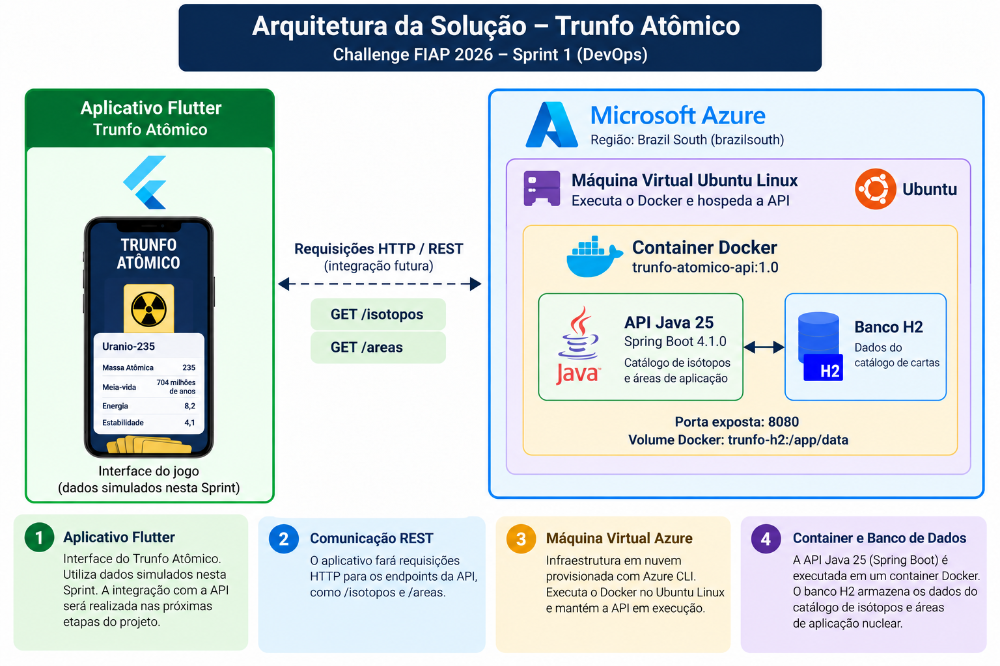

# Trunfo Atômico — DevOps

Challenge FIAP 2026 — Sprint 1

**Parceiro:** AMAZUL / CTMSP  
**Disciplina:** DevOps  
**Responsável:** Thiago — RM: 567486
**Turma:** preencher

## Sobre o projeto

O Trunfo Atômico é um jogo educativo que utiliza cartas de isótopos radioativos para apresentar aplicações da tecnologia nuclear no cotidiano.

## Objetivo de DevOps

Demonstrar a containerização da API Java desenvolvida pelo grupo e sua execução em uma máquina virtual Ubuntu Linux hospedada no Microsoft Azure.

## Tecnologias

- Java 25
- Spring Boot 4.1.0
- Docker
- Azure Virtual Machines
- Azure CLI
- Ubuntu Linux
- GitHub
- Banco de dados H2

## Arquitetura



O aplicativo Flutter representa a interface do jogo, utilizando dados simulados nesta Sprint. A API Java fornece o catálogo de isótopos e é executada em Docker dentro de uma VM Azure.

## Repositório da API

https://github.com/DiegoCPaulino/API-Trunfo-Atomico

## Construção da imagem Docker

Copie o Dockerfile e o .dockerignore deste repositório para a raiz do projeto Java.

Execute:

```bash
docker build -t trunfo-atomico-api:1.0 .
```

## Execução do container

```bash
docker volume create trunfo-h2

docker run -d --name trunfo-api -p 8080:8080 -v trunfo-h2:/app/data trunfo-atomico-api:1.0
```

## Testes

Endpoints:

- GET /isotopos
- GET /areas

## Azure

O provisionamento é realizado com o script `provisionar.sh`, utilizando Azure CLI.

A API é executada em uma máquina virtual Ubuntu Linux com Docker Engine instalado.

A porta de acesso à API deve ser liberada somente para a origem autorizada durante os testes.

## Como Docker e Cloud Computing ajudam a solução?

Docker permite empacotar a aplicação com suas dependências e executar a API de maneira padronizada.

Cloud Computing permite hospedar essa aplicação em infraestrutura remota, facilitando demonstrações, testes e futuras evoluções do sistema.

## Demonstração

**Vídeo:** adicionar link do YouTube não listado após a gravação.

## Encerramento

Após os testes, o grupo de recursos do Azure deve ser excluído. A exclusão precisa ser comprovada na gravação.
