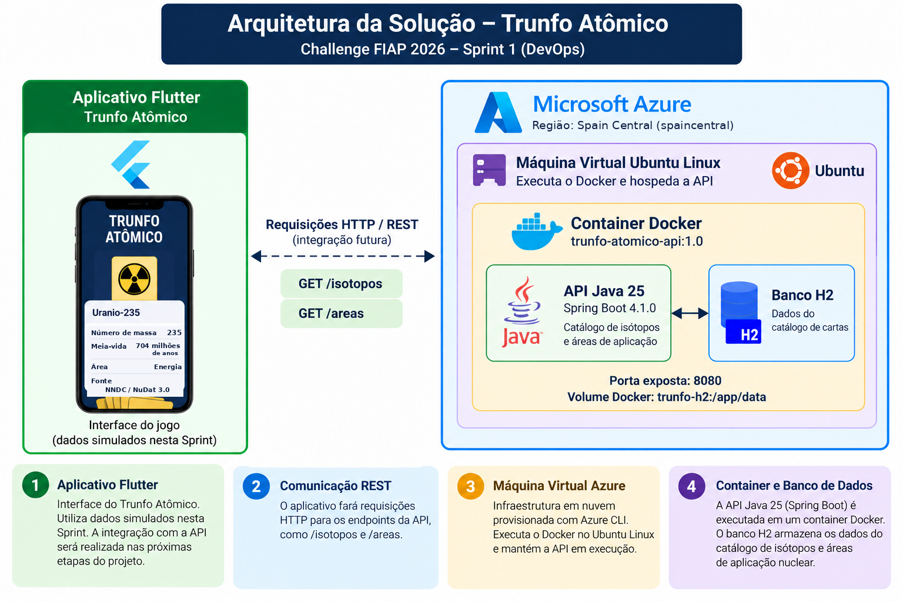

# Trunfo Atômico — DevOps

**Challenge FIAP 2026 — Sprint 1**  
**Parceiro:** AMAZUL / CTMSP  
**Disciplina:** DevOps Tools & Cloud Computing  
**Turma:** 2TDSPR

## Integrantes

| Integrante | RM |
| --- | --- |
| Diego Paulino | 566841 |
| Guilherme Dabul | 559901 |
| Renan Lima | 568321 |
| Ryan Mazali | 567168 |
| Thiago Alexandre | 567486 |

**Responsável pela demonstração de DevOps:** Thiago Alexandre — RM 567486.

## Sobre o projeto

O **Trunfo Atômico** é um jogo educativo que utiliza cartas de isótopos radioativos para apresentar aplicações da tecnologia nuclear no cotidiano.

## Objetivo de DevOps

Demonstrar o provisionamento de uma VM Linux no Microsoft Azure por meio de um script Shell com Azure CLI, a construção de uma imagem Docker da API Java do grupo e a execução do serviço na nuvem, com testes dos endpoints pelo IP público.

## Arquitetura da solução



- **Flutter:** interface do jogo, com dados simulados nesta Sprint. A comunicação REST com a API está prevista para as próximas etapas.
- **Microsoft Azure:** VM `vm-trunfo-atomico`, Ubuntu Server 22.04 LTS, na região Spain Central (`spaincentral`).
- **Tamanho:** `Standard_B2ls_v2`, com 2 vCPUs e 4 GiB de RAM.
- **Docker:** imagem `trunfo-atomico-api:1.0`, construída com Java 25.
- **API:** Java 25 e Spring Boot, com endpoints `GET /areas` e `GET /isotopos`.
- **Persistência:** banco H2 em volume Docker `trunfo-h2`, montado em `/app/data`.
- **Rede:** porta TCP 8080 liberada temporariamente para o IP de origem autorizado durante a demonstração.

## Tecnologias

Java 25 · Spring Boot · Maven · Docker Engine · Azure CLI · Azure Virtual Machines · Ubuntu Linux · H2 · GitHub

## Repositórios

- **DevOps:** https://github.com/thiagoalexandre10/Trunfo-Atomico-DevOps
- **API Java:** https://github.com/DiegoCPaulino/API-Trunfo-Atomico

## Arquivos deste repositório

| Arquivo | Finalidade |
| --- | --- |
| `provisionar.sh` | Cria o grupo de recursos e a VM Azure e consulta seu IP público |
| `Dockerfile` | Compila a API usando Maven e Java 25 e gera a imagem de execução |
| `.dockerignore` | Exclui arquivos desnecessários do contexto de construção |
| `arquitetura.png` | Diagrama da arquitetura da Sprint 1 |
| `README.md` | Documentação e instruções da entrega |

## 1. Provisionamento no Azure

Em um terminal **Git Bash** no Windows, com Azure CLI instalado e autenticado:

```bash
az login
az account show --output table
bash provisionar.sh
```

O script utiliza os seguintes parâmetros:

```bash
RG="rg-trunfo-atomico"
VM="vm-trunfo-atomico"
LOCATION="spaincentral"
SIZE="Standard_B2ls_v2"
USER_NAME="azureuser"
```

Para consultar a VM e seu IP público:

```bash
az vm list --resource-group rg-trunfo-atomico --show-details --output table
az vm show -d --resource-group rg-trunfo-atomico --name vm-trunfo-atomico --query publicIps --output tsv
```

A criação está sujeita às cotas e à disponibilidade da assinatura Azure.

## 2. Acesso SSH e instalação do Docker

Conecte-se à VM, substituindo `IP_PUBLICO_DA_VM`:

```bash
ssh azureuser@IP_PUBLICO_DA_VM
```

**Os comandos seguintes são executados dentro da VM Ubuntu:**

```bash
sudo apt update
sudo apt install -y ca-certificates curl git
sudo install -m 0755 -d /etc/apt/keyrings
sudo curl -fsSL https://download.docker.com/linux/ubuntu/gpg -o /etc/apt/keyrings/docker.asc
sudo chmod a+r /etc/apt/keyrings/docker.asc
```

Criar o arquivo de repositório Docker:

```bash
sudo tee /etc/apt/sources.list.d/docker.sources > /dev/null <<EOF
Types: deb
URIs: https://download.docker.com/linux/ubuntu
Suites: $(. /etc/os-release && echo "${UBUNTU_CODENAME:-$VERSION_CODENAME}")
Components: stable
Architectures: $(dpkg --print-architecture)
Signed-By: /etc/apt/keyrings/docker.asc
EOF
```

Instalar e validar o Docker:

```bash
sudo apt update
sudo apt install -y docker-ce docker-ce-cli containerd.io docker-buildx-plugin
sudo docker --version
sudo docker run --rm hello-world
```

## 3. Construção e execução da API Java

Ainda dentro do Ubuntu:

```bash
git clone https://github.com/DiegoCPaulino/API-Trunfo-Atomico.git
cd API-Trunfo-Atomico

curl -fL https://raw.githubusercontent.com/thiagoalexandre10/Trunfo-Atomico-DevOps/main/Dockerfile -o Dockerfile
curl -fL https://raw.githubusercontent.com/thiagoalexandre10/Trunfo-Atomico-DevOps/main/.dockerignore -o .dockerignore

sudo docker build -t trunfo-atomico-api:1.0 .
sudo docker images
sudo docker volume create trunfo-h2
sudo docker run -d --name trunfo-api -p 8080:8080 -v trunfo-h2:/app/data trunfo-atomico-api:1.0
sudo docker ps
sudo docker logs --tail 30 trunfo-api
```

Teste da API dentro da VM:

```bash
curl -f http://localhost:8080/areas
curl -f http://localhost:8080/isotopos
```

O volume `trunfo-h2` mantém os dados do H2 separados do ciclo de vida do container.

## 4. Liberação controlada da porta 8080

Saia da VM:

```bash
exit
```

No **Git Bash do Windows**, identifique o grupo de segurança de rede:

```bash
az network nsg list --resource-group rg-trunfo-atomico --output table
```

Na demonstração, o NSG utilizado foi `vm-trunfo-atomicoNSG`. Para liberar a porta apenas ao IPv4 público atual do computador:

```bash
az network nsg rule create --resource-group rg-trunfo-atomico --nsg-name vm-trunfo-atomicoNSG --name PermitirTrunfoDemo --priority 1010 --direction Inbound --access Allow --protocol Tcp --source-address-prefixes "$(curl -4 -s https://api.ipify.org)/32" --destination-port-ranges 8080
```

Confirmar a regra:

```bash
az network nsg rule list --resource-group rg-trunfo-atomico --nsg-name vm-trunfo-atomicoNSG --output table
```

> A regra foi utilizada exclusivamente na prova de conceito. O acesso HTTP e o Swagger de desenvolvimento não devem ficar expostos permanentemente à internet.

## 5. Testes pelo IP público do Azure

Substitua `IP_PUBLICO_DA_VM` pelo IP atribuído à VM:

| Endpoint | URL |
| --- | --- |
| Áreas nucleares | `http://IP_PUBLICO_DA_VM:8080/areas` |
| Isótopos | `http://IP_PUBLICO_DA_VM:8080/isotopos?size=20` |
| Swagger UI (se habilitado) | `http://IP_PUBLICO_DA_VM:8080/swagger-ui/index.html` |

A resposta JSON no navegador comprova o acesso à API hospedada no Azure, em vez de somente no `localhost` do computador de desenvolvimento.

## 6. Exclusão dos recursos Azure

Após os testes e a gravação das evidências, confira os recursos antes de remover o grupo:

```bash
az resource list --resource-group rg-trunfo-atomico --output table
az group delete --name rg-trunfo-atomico --yes
az group exists --name rg-trunfo-atomico
```

A resposta `false` do último comando confirma a inexistência do grupo de recursos. A exclusão deve ser realizada apenas se o grupo contiver os recursos da demonstração.

## Como Docker e Cloud Computing ajudam a solução?

O Docker empacota a API Java com suas dependências, padronizando a compilação e a execução no ambiente local e na VM Linux. O volume Docker permite manter os dados do H2 separados do container.

A computação em nuvem permite hospedar a API em uma infraestrutura acessível remotamente, utilizando recursos sob demanda. Em futuras Sprints, o aplicativo Flutter poderá consumir os endpoints REST da API, substituindo os dados simulados desta primeira etapa. O uso temporário da VM e a exclusão após os testes também contribuem para o controle dos custos da prova de conceito.

## Demonstração em vídeo

**Vídeo da Sprint 1 — DevOps (YouTube):** https://youtu.be/BNrjYQzG4n0

O vídeo demonstra provisionamento Azure via script e Azure CLI, instalação do Docker, execução da API Java, teste externo pelo IP público, documentação no GitHub e exclusão do grupo de recursos.

## Entrega final

O PDF da equipe deve conter os nomes, RMs e turma dos integrantes, além dos links do repositório GitHub e do vídeo no YouTube. O vídeo deve estar disponível como **Não listado** para acesso por link.
